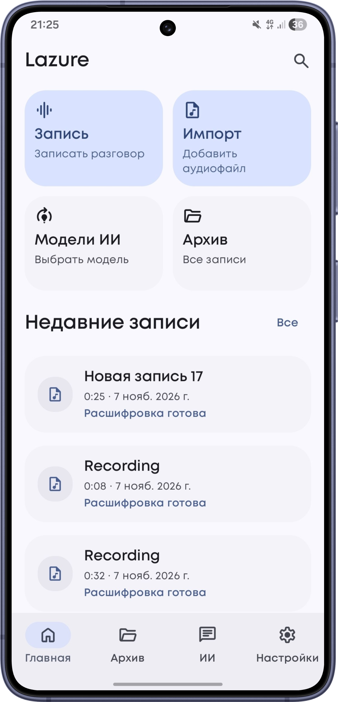
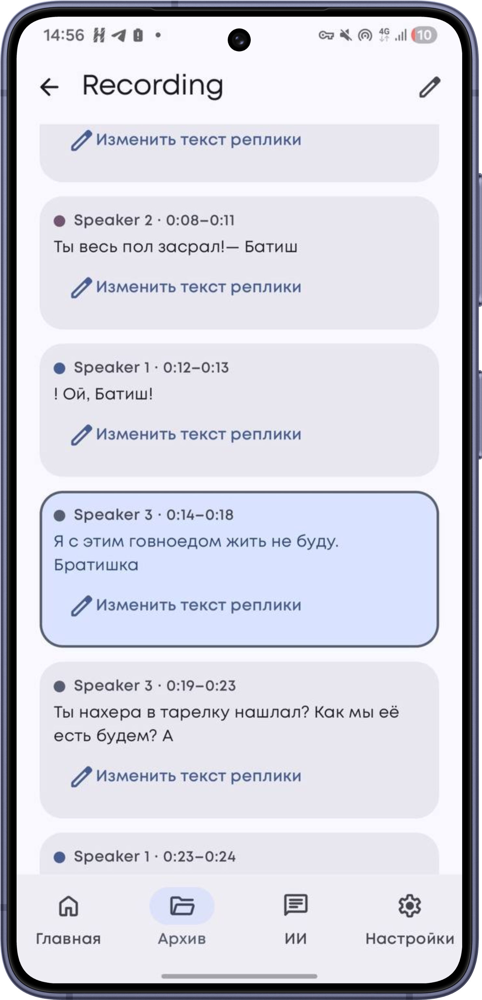
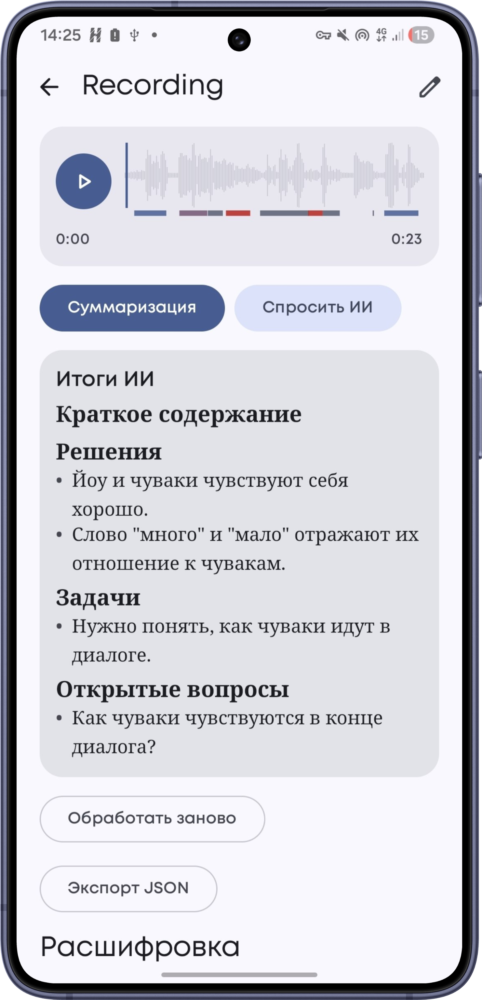
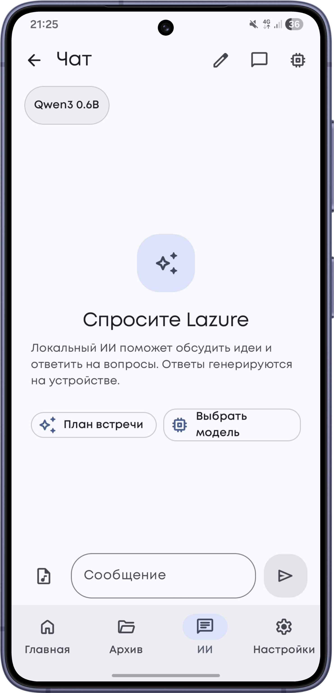

<h1 align="center">Lazure — AI-powered stenographer for Android</h1>

<p align="center">
  <a href="README.ru.md">Русская версия</a>
</p>

<p align="center">
  
  
  
</p>

<p align="center">
  
  
  
  
</p>
<p align="center"><sub>Home · Speaker-labeled transcript · Summary · Chat about a recording · Models. Everything runs on-device; no internet connection is required.</sub></p>

Project submission for the **“AI Stenographer”** challenge (Nuclear IT Hack, KSIT × HEX.TEAM).

[Quick start](#quick-start-for-reviewers) · [Build](#build-from-source) · [Tests](#tests-and-quality-evaluation) · [Documentation](#documentation)

## For reviewers

- **Test device.** The app was tested on a phone with a **MediaTek Helio G99** processor and **3 GB of RAM**. This is a budget phone with older hardware, not a flagship; results should be better on more powerful devices.
- **PIN and screenshots.** When the PIN lock is enabled in Settings, the app window is protected from screenshots and screen recording (`FLAG_SECURE`). Screenshots, recordings, and the recent-apps thumbnail show a black screen. That is why protected screens are not visible in the screenshots or demo video. They are intentionally hidden, not missing or broken. To see the PIN entry screen, disable the PIN in Settings or try the app on a device.
- **Demo video** was recorded on this phone: [`artifacts/demo/demo.mp4`](artifacts/demo/demo.mp4).

Lazure turns an audio recording of a conversation into a structured transcript **on-device, without an internet connection**:

- who is speaking;
- what was said;
- when each utterance started and ended.

Review the result in the app with its built-in player, or export it as JSON using the challenge schema. An on-device LLM can also summarize the conversation and answer questions about it.

| Challenge requirement | Implementation | Source |
| --- | --- | --- |
| Runs on Android | Kotlin + Jetpack Compose, Android 7.0+ (minSdk 24) | `src/mobile/android` |
| Uses an on-device LLM | Qwen3 0.6B INT4 via LiteRT-LM, bundled in the APK for summaries and questions about a recording | `data/recording/RecordingAi.kt`, `data/chat/ChatEngine.kt` |
| Imports audio from device storage | System file picker (SAF); any format supported by Android's decoders | `data/recording/RecordingRepository.kt` |
| Records audio in the app | Foreground service, 16 kHz WAV, system AEC | `service/RecordingService.kt` |
| Converts speech to text | GigaAM v3 CTC with punctuation (sherpa-onnx) | `data/recording/SpeechPipeline.kt` |
| Identifies and separates speakers | pyannote 3.0 + CAM++, refined with sentence embeddings | `SpeechPipeline.refineSpeakers` |
| Adds utterance timestamps | CTC token timings; utterance ends at the next token or at the end of speech detected by VAD | `SpeechPipeline.kt`, `TokenTiming` |
| Displays the transcript | Audio player with waveform, current-utterance highlighting, and tap-to-seek | `ui/recording/` |
| Exports a file | JSON: `{"transcript":[{speaker_id,start_ms,end_ms,text}]}` | `data/recording/TranscriptExport.kt` |
| Keeps processing on-device | No cloud APIs; network access is only used to optionally download other LLMs | — |

Additional features:

- **Enhanced processing:**
  - noise reduction (DTLN), high-pass filtering, and normalization;
  - silence filtering (Silero VAD);
  - more stable speaker identification across utterance boundaries;
  - punctuation;
  - processing progress;
  - playback with navigation to an utterance.
- **Advanced features:**
  - overlapping-speech separation (MossFormer2) and interruption labels;
  - short utterances (“Mm-hmm”, “Yes”) can be assigned to their own speaker;
  - reduced memory use through chunked processing and unloading ASR while separating speakers;
  - edit transcript text and speaker names, merge speakers, and reprocess recordings;
  - processing time and real-time factor (RTF) shown on each recording card.

## Quick start for reviewers

1. Install the APK from the repository's **Releases** page. Speech models and the LLM are bundled in the APK; no internet connection is required.
2. Open the app. On first launch, the bundled LLM is copied to internal storage; this takes a few seconds.
3. Go to **Home → Import** and choose an audio file. Processing starts automatically, and its progress appears on the recording card.
4. When the status changes to **Transcript ready**, the card shows:
   - utterances with speakers and timestamps;
   - processing time and RTF;
   - **Summarize** and **Ask AI** buttons.
5. Tap **Export JSON**, choose where to save the file, and get a transcript in the challenge format.

If you know how many speakers are in the recording, set the count first under **Settings → Recordings → Number of speakers** (default: **Auto**). Overlap separation and noise reduction can be toggled on the **Home → AI models** screen.

## Build from source

Requirements: JDK 21 (Gradle selects the toolchain), Android SDK 36, NDK `27.1.12297006`, and CMake `3.22.1`.

```bash
bash tools/models/fetch_models.sh
```

The script downloads models to `src/mobile/android/src/main/assets/models`, the sherpa-onnx JNI library to `jniLibs`, and the bundled LLM to `assets/bundled_llm`. The MossFormer2 separation model is optional; see `tools/models/export_mossformer2.py` for instructions on preparing it.

```bash
./gradlew :app:assembleRelease -Plazure.abis=arm64-v8a
```

This builds a release APK for phones with R8 enabled and arm64 only. If you do not provide a signing key, the APK is signed with the debug key. To use your own key, set `lazure.storeFile`, `lazure.storePassword`, `lazure.keyAlias`, and `lazure.keyPassword` in `local.properties`. Output: `src/mobile/android/build/outputs/apk/release/app-release.apk`.

```bash
./gradlew :app:assembleDebug
```

This builds a debug APK for emulators (arm64 + x86_64). Run `./run-android.sh [AVD]` to start an emulator, install the app, and open it.

Use a release build for performance measurements: Kotlin code (DSP, clustering) runs noticeably slower in a debuggable app.

## Tests and quality evaluation

```bash
./gradlew :app:testDebugUnitTest
```

Unit tests cover JSON export, timestamps, processing states, recording AI, PIN protection, and more.

```bash
./gradlew :app:connectedDebugAndroidTest
```

Instrumented tests cover database migrations, screens, and the on-device pipeline.

```bash
python3 tools/eval/evaluate.py --ref refs/ --hyp exports/ --timing timing.csv --csv artifacts/test-results/results.csv
```

The evaluation script calculates WER, cpWER, DER, utterance-boundary errors, and RTF.

See [docs/TEST_RESULTS.md](docs/TEST_RESULTS.md) for the methodology and results.

## Documentation

| Document | Contents |
| --- | --- |
| [docs/ARCHITECTURE.md](docs/ARCHITECTURE.md) | Architecture, pipeline, models and licenses, privacy |
| [docs/PROTOCOL.md](docs/PROTOCOL.md) | Input and JSON output formats, utterance and timestamp rules |
| [docs/LIMITATIONS.md](docs/LIMITATIONS.md) | Limitations, demo considerations, roadmap |
| [docs/TEST_RESULTS.md](docs/TEST_RESULTS.md) | Test methodology and results |
| [docs/DEVELOPMENT_LOG.md](docs/DEVELOPMENT_LOG.md) | Development log: decisions and root causes of issues |
| [docs/presentation/Lazure.pdf](docs/presentation/Lazure.pdf) | Project presentation (PDF) |
| [artifacts/demo](artifacts/demo) | Demo video |
| [artifacts/test-results](artifacts/test-results) | Evaluation script results |

## Repository structure

```
src/mobile/android/     Android app (module :app)
  src/main/java/com/rassvet/essential/
    data/recording/     recognition pipeline, queue, export, recording AI
    data/llm/           on-device LLM (LiteRT-LM), model catalog and downloads
    data/local/         Room database and settings
    ui/                 Compose screens
  src/main/java/com/k2fsa/sherpa/onnx/   sherpa-onnx Kotlin API
tools/models/           model manifest and downloader, MossFormer2 export
tools/eval/             WER / cpWER / DER / timestamp / RTF evaluation
tools/bench/            synthetic diarization benchmark
docs/                   hackathon documentation
  presentation/         project presentation (PDF)
  screenshots/          README screenshots
artifacts/              demo and test results
config/                 sample environment variables for scripts
```

## Tech stack

Kotlin, Jetpack Compose, Material 3, Hilt, Room, DataStore; sherpa-onnx 2.0.1 (ONNX Runtime), onnxruntime-android 1.28, LiteRT-LM 0.12. Models: Silero VAD, GigaAM v3 CTC, pyannote segmentation 3.0, 3D-Speaker CAM++, DTLN, MossFormer2, and Qwen3 0.6B.
